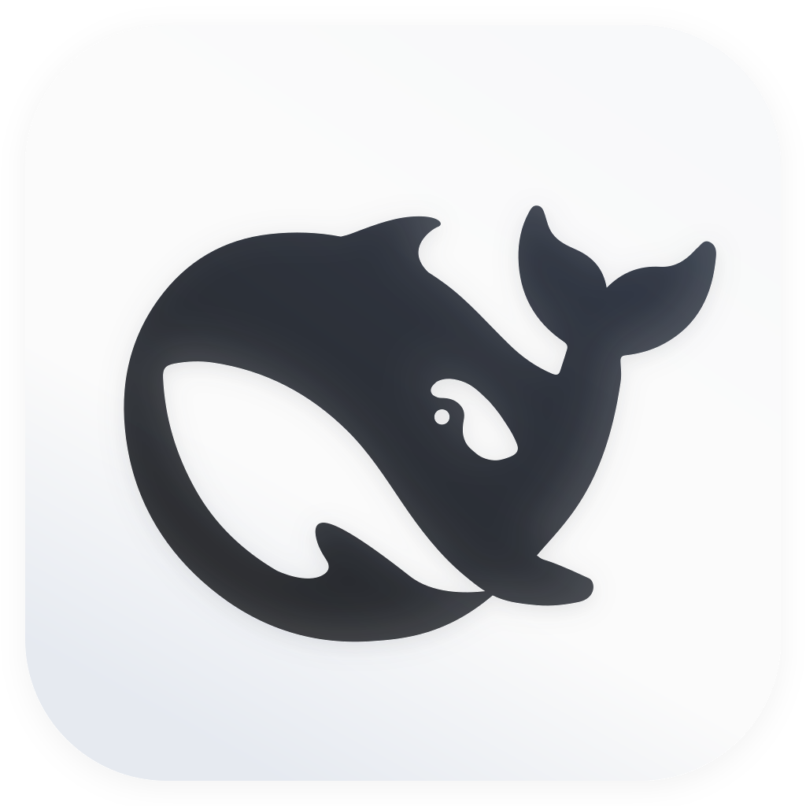

# Meldwork General Agent 目录

[返回 README](README.zh-CN.md)

## General Agent 目录

### 快速安装

设置 → Agents 在 macOS 和 Windows 上为有安装配方的 Agent 提供安装入口。确认后才执行；npm 配方需要已安装 Node.js/npm，并使用固定版本和完整性校验。安装器使用原生 shell 环境。安装不代表已登录或已获知识库访问权限；Zcode 等尚无配方的 Agent 仍需手动安装。

设置 → 知识库可在确认后通过 npm 安装官方飞书和钉钉 CLI，随后重新检测；登录和授权仍通过 CLI 原生流程完成。Obsidian 仍使用官方下载入口及你选择的 vault 目录。

当适配器和 CLI 版本兼容时，Meldwork 会检测并调用已安装的 Agent 命令。当前目录包括：

<table>
  <tr>
    <td align="center" valign="top"> <strong>Codex</strong></td>
    <td align="center" valign="top"> <strong>Hermes</strong></td>
    <td align="center" valign="top"> <strong>OpenClaw</strong></td>
    <td align="center" valign="top"> <strong>WorkBuddy</strong></td>
    <td align="center" valign="top"> <strong>Zcode</strong></td>
    <td align="center" valign="top"> <strong>Pi Agent</strong></td>
    <td align="center" valign="top"> <strong>Kimi Code</strong></td>
  </tr>
  <tr>
    <td align="center" valign="top"> <strong>MiMo Code</strong></td>
    <td align="center" valign="top"> <strong>Claude Code</strong></td>
    <td align="center" valign="top"> <strong>Gemini CLI</strong></td>
    <td align="center" valign="top"> <strong>OpenCode</strong></td>
    <td align="center" valign="top"> <strong>Qwen Code</strong></td>
    <td align="center" valign="top"> <strong>OpenCodeReview</strong></td>
    <td align="center" valign="top"> <strong>DeepSeek Harness</strong></td>
  </tr>
</table>

已批准的 Agent Connector 和自定义可执行 Agent 使用桌面端的连接器入口。完整的适配器、安装、Provider 和能力矩阵见[桌面端指南](desktop/README.md)。
[Agent Connector SDK 指南](desktop/AGENT_CONNECTOR_SDK.md)介绍当前支持的包、审批、升级和一致性检查。

DeepSeek Harness（`dsh`）通过 ACP 支持私聊与群聊，各对话使用独立、可续接的原生会话，并遵守工作区权限。默认模型为 ZGCI `smart-router-v2`；凭据通过原生服务或启动环境中的 `ZGCI_API_KEY` 提供。在「设置 → Agent → DeepSeek Harness」中可以选择已有的原生 `DSH_HOME` 目录，探测、运行和本地 Skill 都会使用该目录。原生环境变量 `DSH_AGENTS_HOME` 也可指定共享 Skill 目录。图标使用官方 macOS 客户端资源。
如果原生 ACP profile 或 DSH home 补丁显式指定了 Provider 或模型，Meldwork 会优先使用该配置，并传递其中声明的凭据环境变量。

WorkBuddy 也可以在「设置 → Agent」中选择已有的原生配置目录；模型列表、执行环境以及本地和插件 Skill 都会使用所选目录。

OpenClaw 也可以在「设置 → Agent」中选择原生状态目录。Meldwork 会从该目录读取所选 Agent 的模型配置，并在受保护的本地运行环境中执行。

切换 Agent 的原生配置目录时，Meldwork 会按目录分别保存本地会话，切回原目录后恢复对应会话。任务运行中或等待恢复时，暂时不能切换配置。

Zcode 请选择包含 `config.json` 的 `.zcode/cli` 目录。运行时 Zcode 会使用该目录所属的用户主目录，这也会影响其会话及其他文件中的主目录相对路径；项目配置仍可能覆盖用户配置。

Qwen Code 请选择包含设置或认证文件的 `.qwen` 目录。Qwen 会使用其所属的用户主目录保存原生会话、读取 Skill 和其他主目录相对文件；项目和系统设置仍遵循原生优先级。

Hermes 使用自身的 `config.yaml` 和 Provider 设置。如果模型、备用模型或 Provider 条目通过 `key_env` 或 `api_key_env` 声明凭据变量，Meldwork 会从启动环境或登录 shell 中读取这些变量并交给 Hermes；无关变量和不安全的进程控制变量会被排除。首次使用新的原生数据目录启动时，Hermes 可能会自行准备依赖。
