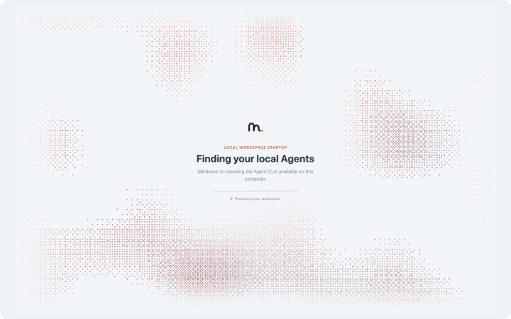
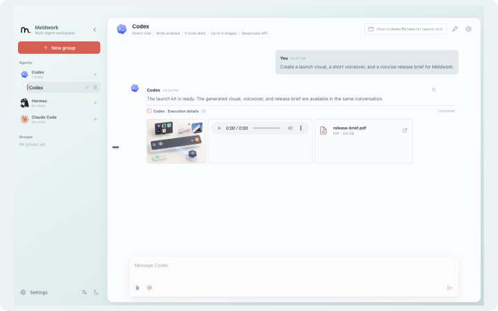
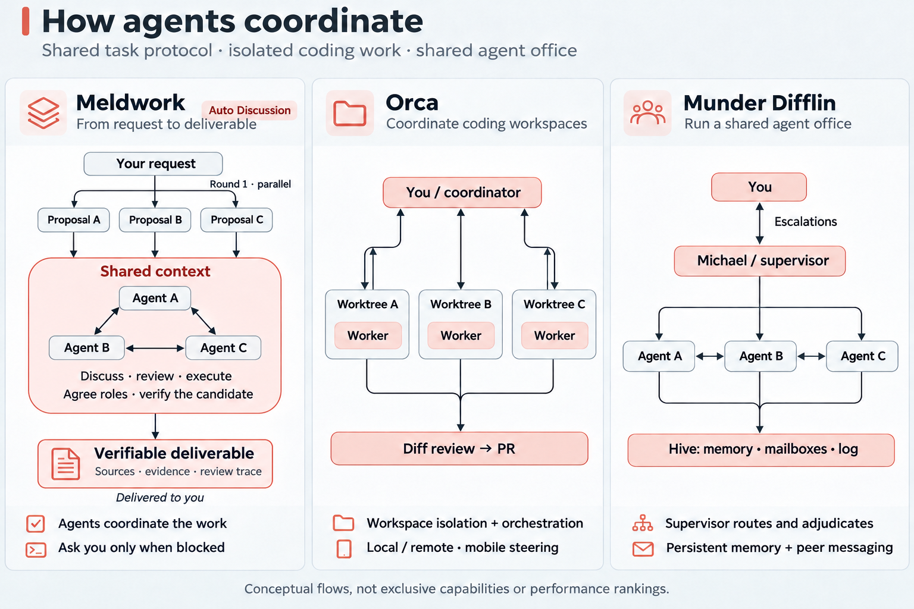
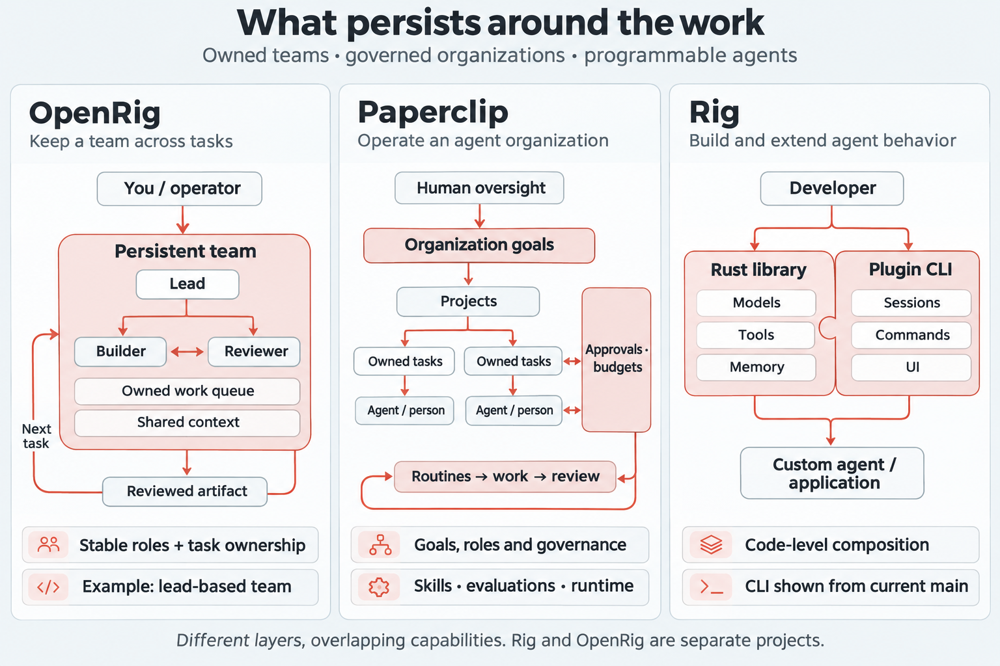

<p align="center">
  
</p>

# Meldwork — Let Agents collaborate to move tasks forward

**Set the goal. Let Agents work together. Meldwork brings your existing Agents into one working group to share context, discuss approaches, carry out work, and check each other's results — with less relaying, prompting, and stitching outputs together.**

Meldwork is a local-first multi-Agent collaboration workspace for the Agent tools you already use on your Mac. Once you choose the participants, goal, context, and permissions, Agents in Auto Discussion can build on each other's work, request contributions or reviews, and advance the task within the authorized scope. Direct conversations and independent concurrent responses also support research, analysis, writing, planning, review, and implementation.

You do not need to direct every round, but you still set the goal, grant permissions, and make key decisions. Missing information, permission requests, or tradeoffs may require your input. Workspace writes are opt-in; collaboration history, run state, and deliverables stay local so you can revisit the work and continue it.

<p align="center">
  <a href="https://github.com/Ryder-Sun/Meldwork/releases"></a>
  &nbsp; <a href="https://youtu.be/ttyJxo1s9ns"></a>
  &nbsp; <a href="architecture.md"></a>
  &nbsp; <a href="LICENSE"></a>
  &nbsp; <a href="README.zh-CN.md"></a>
</p>

## What Meldwork is for

<table>
  <tr>
    <td width="33%" align="center" valign="top">
      <a href="assets/meldwork-agent-discovery.png"></a>
      <p><sub>Agent discovery</sub></p>
    </td>
    <td width="33%" align="center" valign="top">
      <a href="assets/meldwork-auto-discussion.png"></a>
      <p><sub>Auto discussion &amp; run details</sub></p>
    </td>
    <td width="33%" align="center" valign="top">
      <a href="assets/meldwork-direct-multimodal.png"></a>
      <p><sub>Direct multimodal conversation</sub></p>
    </td>
  </tr>
</table>

Meldwork is useful when several Agents need to advance the same task and you want to spend less time passing context and coordinating next steps. Typical work includes:

- research and information synthesis across local Agent tools and selected knowledge sources;
- product, market, operational, and technical analysis;
- writing, planning, review, and structured document work;
- multimodal work with local documents, images, audio, video, PDFs, and code or configuration files;
- implementation in an authorized workspace, with other Agents checking the deliverables and requesting revisions.

## How a task moves through Meldwork

1. **Select** the Agents that will work on the task together.
2. **Scope** the goal, working directory, context, attachments, Skills, knowledge sources, and permissions.
3. **Collaborate** in Auto Discussion: let Agents discuss approaches, carry out authorized work, and check results. Direct conversations and Concurrent Responses are also available.
4. **Decide** when the work needs information, permission, or a tradeoff resolved.
5. **Check the result** and request changes when more work is needed.

## Collaboration modes

| Mode | What happens | Best for |
| --- | --- | --- |
| **Direct** | One selected Agent keeps its conversation and native session when supported. | Focused research, writing, analysis, or execution. |
| **Concurrent Responses** | Selected Agents receive the same frozen task snapshot and return independent responses in stable order. | Comparing perspectives before choosing a path. |
| **Auto Discussion V4** | Agents propose independently, discuss, request peer contributions, carry out authorized work, and check deliverables. A delivery owner judges progress and requests user decisions when needed. Native sessions continue when supported. | Multi-step collaboration with less manual coordination. |

Participants are selected by the user. Automatic selection from a larger roster is outside the current preview.

## Revisit the process and continue the work

Meldwork keeps task context, Agent replies, run state, and deliverables locally so you can see how work progressed, where it stalled, and what needs attention next. The Run Ledger preserves phase, participant, attempt, artifact, recovery, and Human Gate state. Diagnostic tool output and sensitive runtime details stay behind the Electron main-process boundary.

These records help you inspect collaboration; they do not establish that every claim has been fact-checked. Peer review does not guarantee correctness, and important deliverables still need acceptance checks appropriate to their use.

## Core design and related tools

Give Meldwork your original request. In Auto Discussion, Agents first propose solutions in parallel, then discuss and review them within a shared task context. They agree on responsibilities, carry out the work and verify the candidate without asking you to coordinate each step. The workflow aims to deliver a verifiable, traceable artifact with source references, evidence and review records. Human input is an exception for missing authorization or a blocker the Agents cannot resolve within the agreed scope; you do not routinely approve proposals or relay messages between Agents.

<table><tr>
<td width="50%"><a href="assets/readme/coordination-models-en.png"></a></td>
<td width="50%"><a href="assets/readme/organization-models-en.png"></a></td>
</tr></table>

| Project | What organizes the work |
| --- | --- |
| **Meldwork** | Your request → parallel proposals → autonomous discussion, review and execution in shared context → a verifiable, traceable deliverable |
| [Orca](https://github.com/stablyai/orca) | Coding workspaces and worktrees; coordinator Agents can also decompose tasks and manage workers |
| [Munder Difflin](https://github.com/HarnessMD/munder-difflin) | An Agent office led by Michael, with shared memory and mailboxes |
| [Paperclip](https://github.com/paperclipai/paperclip) | Organization goals, task ownership, roles, budgets and approvals |
| [OpenRig](https://github.com/mvschwarz/openrig) | Persistent teams with leads, specialist roles, shared context and owned work |
| [Rig](https://github.com/0xplaygrounds/rig) | Rust LLM application development; current main also includes a plugin-based terminal Agent |

Choose Meldwork when you want selected native Agents to negotiate and check a shared task within a local desktop workflow. Shared context, peer review and human approvals also exist in the other tools; the protocol and its integration are the distinction to evaluate. Agreement does not guarantee correctness, and this comparison does not establish better outcomes. The diagrams show selected organizing patterns, not exhaustive architectures. Rig and OpenRig are separate projects. [Sources and comparison scope](assets/readme/RELATED_TOOLS.md), checked 2026-11-12.

## General Agent catalog

See the [separate catalog](CATALOG.md) for supported Agents, native configuration directories and authentication, and the [desktop guide](desktop/README.md) for the installation and capability matrix.

## Context and local boundaries

Meldwork runs as a local Electron application. Conversations, group configuration, run records, and app-owned attachments stay in the local user data directory. The renderer receives only validated snapshots through a narrow preload API; executable paths, credentials, native session references, Skill paths, and unrestricted shell access remain in the main process.

Selected Agents may send prompts, attachments, or Skills to the model provider configured in their own CLI. Knowledge access is explicit and bounded: the current implementation supports local Obsidian retrieval and CLI-owned Feishu or DingTalk access modes. Local-first describes where Meldwork stores and coordinates work; it does not promise that an Agent's model provider is offline.

## Run from source

Prerequisites: Node.js `22.12+` and npm.

```bash
npm --prefix frontend ci
npm --prefix desktop ci
npm --prefix desktop run dev
```

Before distributing a build:

```bash
npm --prefix frontend test
npm --prefix frontend run build
npm --prefix frontend run build:desktop
npm --prefix desktop test
```

## Documentation

- [Architecture and product boundary](architecture.md)
- [Desktop setup and Agent matrix](desktop/README.md)
- [Contributing](CONTRIBUTING.md)
- [Security policy](SECURITY.md)

## License

Meldwork is open source under the [Apache License 2.0](LICENSE). Commercial use, private use, modification, and redistribution are permitted under the license terms. No separate commercial authorization or license fee is required. Apache-2.0 does not grant trademark rights; see [COMMERCIAL_USE.md](COMMERCIAL_USE.md).
