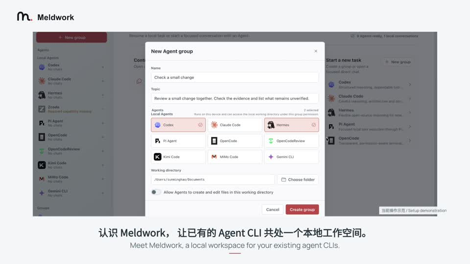
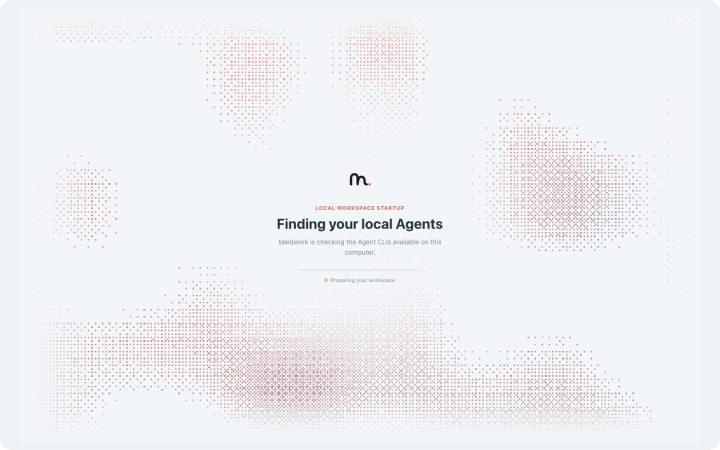
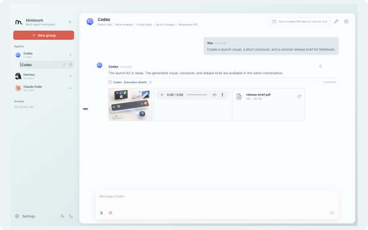

<p align="center">
  
</p>

# Meldwork：让 Agent 自主协作推进任务

**提出目标，让 Agent 们协作完成。Meldwork 把你已有的 Agent 组织成一个工作小组，共享上下文、讨论方案、协作执行并相互检查，减少你在它们之间转述、催办和整合结果的工作。**

Meldwork 是一个本地优先的多 Agent 协作工作空间，用来连接你已经在电脑上使用的 Agent 工具。你选定参与者、目标、上下文和权限后，自动讨论中的 Agent 可以接续彼此的工作，请求同伴补充或检查，并在授权范围内推进任务。它也支持单个 Agent 的直接会话和多个 Agent 的独立并发回复，覆盖研究、分析、写作、规划、评审和实施。

你无需安排每一轮发言，但仍负责目标、权限和关键决策。遇到信息缺失、权限请求或需要取舍的问题时，任务可能等待你处理。工作区写入需要明确授权；协作过程、运行状态和产物保存在本地，方便回看和继续工作。

<p align="center">
  <a href="https://github.com/Ryder-Sun/Meldwork/releases"></a>
  &nbsp; <a href="https://youtu.be/ttyJxo1s9ns"></a>
  &nbsp; <a href="architecture.md"></a>
  &nbsp; <a href="LICENSE"></a>
  &nbsp; <a href="README.md"></a>
</p>

## Meldwork 适合什么工作

[](https://youtu.be/ttyJxo1s9ns)

[在 YouTube 观看产品宣传视频](https://youtu.be/ttyJxo1s9ns)
<table>
  <tr>
    <td width="33%" align="center" valign="top">
      <a href="assets/meldwork-agent-discovery.png"></a>
      <p><sub>Agent 发现</sub></p>
    </td>
    <td width="33%" align="center" valign="top">
      <a href="assets/meldwork-auto-discussion.png"></a>
      <p><sub>自动讨论与运行详情</sub></p>
    </td>
    <td width="33%" align="center" valign="top">
      <a href="assets/meldwork-direct-multimodal.png"></a>
      <p><sub>多模态直接会话</sub></p>
    </td>
  </tr>
</table>

当一个任务需要多个 Agent 共同推进，而你不想反复传递上下文、协调下一步时，Meldwork 更适合：

- 研究与信息综合：结合本地 Agent 工具和明确选择的知识源；
- 产品、市场、运营和技术分析；
- 写作、规划、评审和结构化文档工作；
- 处理本地文档、图片、音频、视频、PDF、代码和配置文件的多模态工作；
- 在授权工作目录内执行、由其他 Agent 检查成果并继续修改的实施工作。

## 一个任务如何在 Meldwork 中推进

1. **选择**一起处理任务的 Agent。
2. **限定**目标、工作目录、上下文、附件、Skill、知识源和权限。
3. **协作**：启动 Auto Discussion，让 Agent 讨论方案、接续执行并检查成果；也可选择直接会话或并发回复。
4. **决策**：在需要补充信息、授权或取舍时介入。
5. **查看结果**：检查交付物，必要时提出修改，让工作继续推进。

## 协作模式

| 模式 | 运行方式 | 适合场景 |
| --- | --- | --- |
| **直接会话** | 一个已选 Agent 在适配器支持时保持对话和原生会话。 | 聚焦研究、写作、分析或执行。 |
| **并发回复** | 已选 Agent 收到同一份冻结任务快照，并按稳定顺序返回独立回复。 | 在选择方案前比较不同视角。 |
| **Auto Discussion V4** | Agent 独立提出方案后，接续讨论、请求同伴贡献、在授权范围内执行并检查成果。交付负责人判断任务进度，必要时请求用户决策；支持时保持原生会话。 | 希望减少人工协调的多步骤协作任务。 |

参与者始终由用户选择。从更大候选池自动选人组队不属于当前预览版。

## 过程可回看，工作可继续

Meldwork 在本地保留任务上下文、Agent 回复、运行状态和产物，方便了解任务如何推进、哪里遇到阻塞，以及接下来需要处理什么。Run Ledger 保留阶段、参与者、尝试、产物、恢复状态和人工审批门；诊断工具输出与敏感运行信息留在 Electron 主进程边界内。

过程记录帮助检查协作情况，不代表每条结论都经过事实核验。Agent 的相互检查也不能保证结果正确，重要交付物仍需按实际用途验收。

## General Agent 目录

当适配器和 CLI 版本兼容时，Meldwork 会检测并调用已安装的 Agent 命令。当前目录包括：

<table>
  <tr>
    <td align="center" valign="top"><br><strong>Codex</strong></td>
    <td align="center" valign="top"><br><strong>Hermes</strong></td>
    <td align="center" valign="top"><br><strong>OpenClaw</strong></td>
    <td align="center" valign="top"><br><strong>WorkBuddy</strong></td>
    <td align="center" valign="top"><br><strong>Zcode</strong></td>
    <td align="center" valign="top"><br><strong>Pi Agent</strong></td>
    <td align="center" valign="top"><br><strong>Kimi Code</strong></td>
  </tr>
  <tr>
    <td align="center" valign="top"><br><strong>MiMo Code</strong></td>
    <td align="center" valign="top"><br><strong>Claude Code</strong></td>
    <td align="center" valign="top"><br><strong>Gemini CLI</strong></td>
    <td align="center" valign="top"><br><strong>OpenCode</strong></td>
    <td align="center" valign="top"><br><strong>Qwen Code</strong></td>
    <td align="center" valign="top"><br><strong>OpenCodeReview</strong></td>
    <td align="center" valign="top"><br><strong>DeepSeek Harness</strong></td>
  </tr>
</table>

已批准的 Agent Connector 和自定义可执行 Agent 使用桌面端的连接器入口。完整的适配器、安装、Provider 和能力矩阵见[桌面端指南](desktop/README.md)。
[Agent Connector SDK 指南](desktop/AGENT_CONNECTOR_SDK.md)介绍当前支持的包、审批、升级和一致性检查。

DeepSeek Harness（`dsh`）通过 ACP 支持私聊与群聊，各对话使用独立、可续接的原生会话，并遵守工作区权限。默认模型为 ZGCI `smart-router-v2`；凭据通过原生服务或启动环境中的 `ZGCI_API_KEY` 提供。在「设置 → Agent → DeepSeek Harness」中可以选择已有的原生 `DSH_HOME` 目录，探测、运行和本地 Skill 都会使用该目录。原生环境变量 `DSH_AGENTS_HOME` 也可指定共享 Skill 目录。图标使用官方 macOS 客户端资源。
如果原生 ACP profile 或 DSH home 补丁显式指定了 Provider 或模型，Meldwork 会优先使用该配置，并传递其中声明的凭据环境变量。

WorkBuddy 也可以在「设置 → Agent」中选择已有的原生配置目录；模型列表、执行环境以及本地和插件 Skill 都会使用所选目录。

切换 Agent 的原生配置目录时，Meldwork 会按目录分别保存本地会话，切回原目录后恢复对应会话。任务运行中或等待恢复时，暂时不能切换配置。

Zcode 请选择包含 `config.json` 的 `.zcode/cli` 目录。运行时 Zcode 会使用该目录所属的用户主目录，这也会影响其会话及其他文件中的主目录相对路径；项目配置仍可能覆盖用户配置。

Qwen Code 请选择包含设置或认证文件的 `.qwen` 目录。Qwen 会使用其所属的用户主目录保存原生会话、读取 Skill 和其他主目录相对文件；项目和系统设置仍遵循原生优先级。

Hermes 使用自身的 `config.yaml` 和 Provider 设置。如果模型、备用模型或 Provider 条目通过 `key_env` 或 `api_key_env` 声明凭据变量，Meldwork 会从启动环境或登录 shell 中读取这些变量并交给 Hermes；无关变量和不安全的进程控制变量会被排除。首次使用新的原生数据目录启动时，Hermes 可能会自行准备依赖。

## 上下文与本地边界

Meldwork 作为本地 Electron 应用运行。对话、群组配置、运行记录和应用管理的附件保存在本地用户数据目录。渲染进程只通过受约束的 preload API 获取校验后的状态；可执行路径、凭据、原生会话引用、Skill 路径和任意 Shell 权限都留在主进程中。

选定的 Agent 仍可能把 Prompt、附件或 Skill 发送到其自身 CLI 凭据对应的模型服务商。知识访问必须明确选择并受边界约束：当前实现支持本地 Obsidian 检索，以及由本地 CLI 管理的飞书或钉钉访问模式。Local-first 描述的是 Meldwork 的数据和协作位置，不代表 Agent 使用的模型服务商一定离线。

## 从源码运行

前置条件：Node.js `22.12+` 和 npm。

```bash
npm --prefix frontend ci
npm --prefix desktop ci
npm --prefix desktop run dev
```

分发构建前运行：

```bash
npm --prefix frontend test
npm --prefix frontend run build
npm --prefix frontend run build:desktop
npm --prefix desktop test
```

## 文档

- [架构与产品边界](architecture.md)
- [桌面端设置与 Agent 矩阵](desktop/README.md)
- [贡献指南](CONTRIBUTING.md)
- [安全策略](SECURITY.md)

## 许可证

Meldwork 以 [Apache License 2.0](LICENSE) 开源。在许可证条款范围内，可以商用、私用、修改和再分发。商用无需另行授权或支付许可费。Apache-2.0 不授予商标权；详见 [COMMERCIAL_USE.md](COMMERCIAL_USE.md)。
